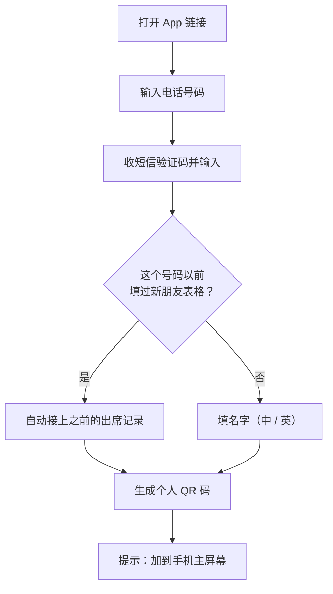
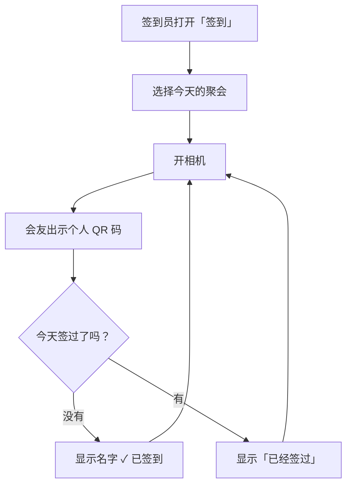
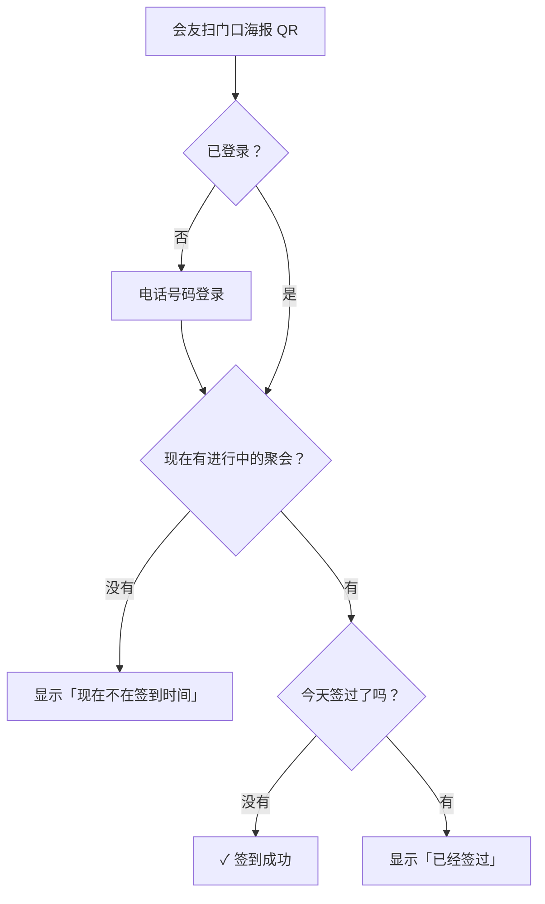
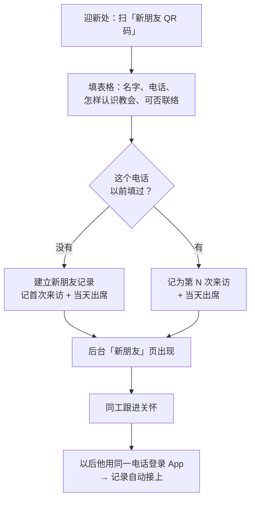
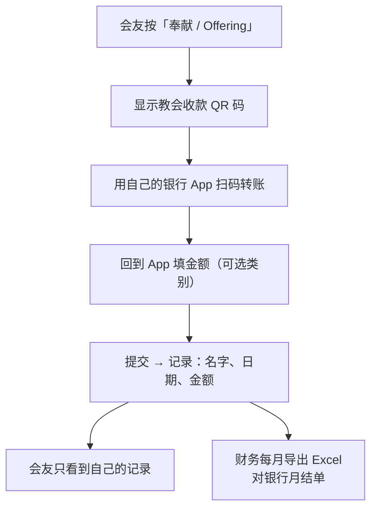
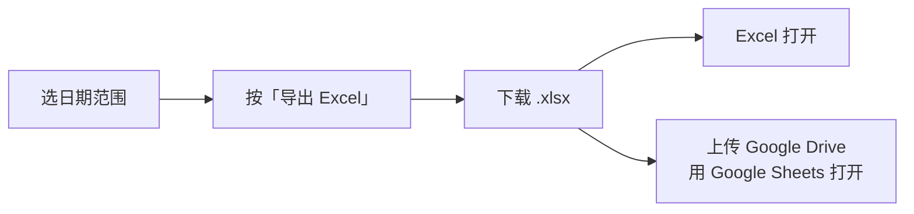
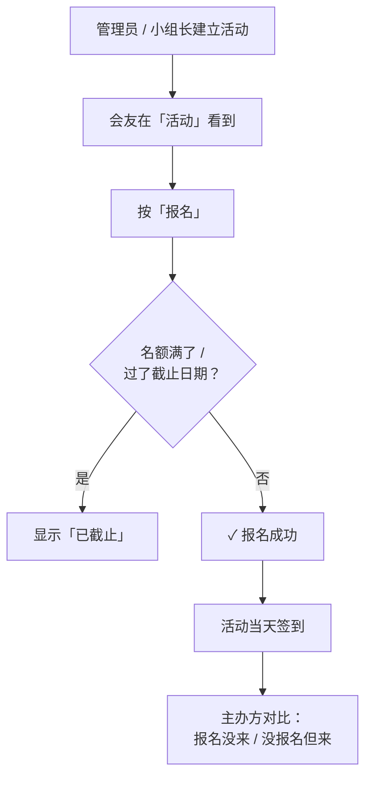

# 教会出席与奉献 App — 项目总览

> 更新日期：2026-10-15 ｜ 状态：设计草稿，尚未开工
> 详细设计：[`superpowers/specs/2026-10-15-church-attendance-pwa-design.md`](superpowers/specs/2026-10-15-church-attendance-pwa-design.md)

---

## 1. 一句话说明

一个装在手机上的教会 App（PWA，不用上 App Store），会友用 **电话号码** 登录，可以 **签到、记录奉献、报名活动、看公告**；同工在后台看 **出席率、新朋友、奉献记录**，并导出 Excel。界面 **华语 / English** 可切换。

## 2. 整体思路

| 原则 | 意思 |
|---|---|
| 门口要快 | 签到不能造成排队：扫一下就好，不用按确认 |
| 新朋友零门槛 | 第一次来的人不用装 App、不用收短信，填一张短表格就好 |
| 奉献隐私 | 奉献记录只有财务和管理员看得到，会友只看自己的 |
| 权限在服务器 | 不是只把按钮藏起来，而是数据库本身就拒绝没权限的人 |
| 教会拥有资料 | 项目挂在教会的 Google 账号下，不挂在个人名下 |
| 先做每周用的 | 第一期只做签到和奉献，先上线、先发现问题，再加其他功能 |

## 3. 角色

| 角色 | 能做什么 | 看得到奉献？ |
|---|---|---|
| 新朋友 | 填迎新表格（免登录） | — |
| 会友 | 个人 QR 码、自助签到、填自己的奉献、看自己的记录 | 只看自己 |
| 签到员 | 在门口扫会友的 QR 码 | ✗ |
| 小组长 | 开小组聚会、帮组员签到、看自己小组出席 | ✗ |
| 财务 | 看全部奉献、导出 Excel | ✓ |
| 教会管理员 | 全部权限：换收款 QR、指派角色、改会友身份、合并重复资料 | ✓ |

一个人可以同时有几个角色。

**会友身份：** 新朋友 → 常来的朋友 → 正式会友（由管理员调整）

---

## 4. 第一期：每周都要用的核心

| # | 功能 | 说明 |
|---|---|---|
| 1 | 电话号码登录 | 短信验证码，登录后一直保持登录 |
| 2 | 个人 QR 码 | 登录后自动生成，不含电话号码 |
| 3 | 聚会管理 | 主日每周自动产生；小组 / 活动由小组长或管理员开 |
| 4 | 签到 A：签到员扫会友 | 连续扫码，每人每场只记一次 |
| 5 | 签到 B：会友扫教会 QR | 门口固定海报，自动对应「现在这场聚会」；可设长期有效或限时 |
| 6 | 新朋友登记 | 独立的新朋友 QR 码 → 短表格 → 自动记首次来访和当天出席 |
| 7 | 新朋友后台 | 本周新朋友、第几次来、多久没来 |
| 8 | 奉献 | 显示教会收款 QR → 会友用银行 App 转账 → 回来填金额 |
| 9 | 权限与角色 | 见上面的角色表 |
| 10 | 导出 Excel | 出席、奉献、合并表、出席率，四张工作表 |
| 11 | 双语 | 华语 / English 切换 |

## 5. 第二期：社群功能

| # | 功能 | 说明 |
|---|---|---|
| 1 | 活动页 | 时间、地点、详情、海报 |
| 2 | 活动报名 | 一键报名，可设名额上限和截止日期 |
| 3 | 报名名单 | 主办方查看、导出；当天对比「报名没来 / 没报名但来」 |
| 4 | 公告栏 | 管理员发布，打开 App 就看到 |
| 5 | 小组资讯 | 每组一页：组长、时间、地点、近期消息 |

**暂时不做：** 手机推送通知、实时同步 Google Sheet、App 内直接付款。

---

## 6. 主要流程

### 6.1 会友第一次使用

### 6.2 主日签到 A：门口签到员扫会友

网络不稳时，先存在手机里，有网络后自动送出。

### 6.3 主日签到 B：会友自己扫码

### 6.4 新朋友

### 6.5 奉献

App 不经手钱，也不知道钱有没有到账。金额由会友自填，所以财务需要定期对账。

### 6.6 财务 / 管理员导出 Excel

| 工作表 | 内容 |
|---|---|
| 1. 出席记录 | 日期、聚会、名字、签到方式 |
| 2. 奉献记录 | 日期、名字、类别、金额 |
| 3. 合并表 | 每个会友 × 每场聚会：出席与否 + 当天奉献 |
| 4. 出席率 | 每个会友、每个小组在该期间的出席率 |

### 6.7 （第二期）活动报名

---

## 7. 技术选择

| 项目 | 选择 | 原因 |
|---|---|---|
| App 形式 | PWA | 不用上架 App Store / Play Store，链接打开就能用 |
| 后端 | Firebase | 有现成登录和权限控制；不会像 Supabase 免费版那样闲置 7 天就暂停 |
| 登录 | 电话号码 + 短信 | 用户决定；同一人不会因为不同登录方式被拆成两个账号 |
| 方案 | Firebase Blaze（按用量付费） | 短信登录必须用这个方案，要绑信用卡 |
| 导出 | .xlsx | Excel 和 Google Sheets 都能打开 |

**费用预估：** 200 人规模，资料库和网站在免费额度内；主要开销是短信，一年几百条（按国家计价）。
**一定要设：** 每月预算提醒 + 短信只允许发往本国（防止被刷短信）。

## 8. 上线前要准备的（教会这边）

1. 用 **教会的 Google 账号** 开 Firebase 项目，把开发者加为管理员
2. 绑信用卡，开 Blaze 方案，设预算提醒
3. 准备教会收款 QR 码图片
4. 定好主日聚会时间、第一批管理员 / 财务 / 签到员名单
5. 印两张海报：「签到 QR 码」和「新朋友 QR 码」

## 9. 还没决定的事

| # | 问题 | 为什么重要 |
|---|---|---|
| 1 | 一家人共用一支手机、或小孩没有手机，要不要支持「一个账号管理几个家人」？ | 会改变资料结构，要在开工前定 |
| 2 | 教会在哪个国家？ | 决定电话格式、短信地区、货币、个人资料保护法规 |
